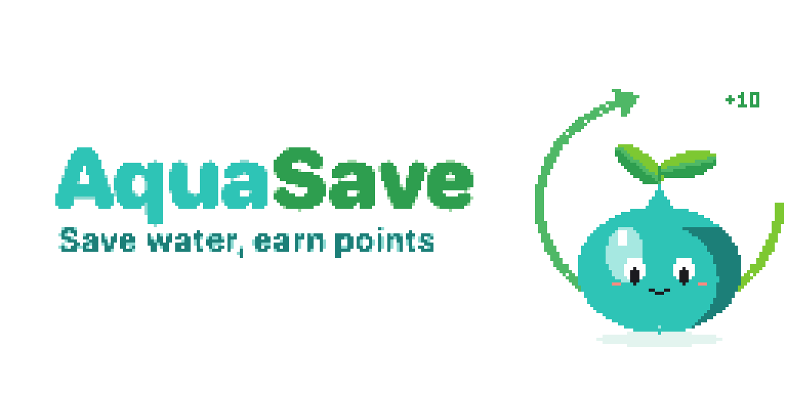

# AquaSave: Water Sensor Companion

**Use less water, earn credits.** AquaSave is the iPhone app for a family of small sensors that clip onto taps, shower heads and appliances. The sensors measure every liter your home uses and every liter it wastes. The app measures your home's usual day, sets a daily limit that steps down toward an efficient target, and pays credits for every liter you save. Credits buy sensor discounts, Amazon and Spotify gift cards, or clean water for a family in need.

<p align="center">
  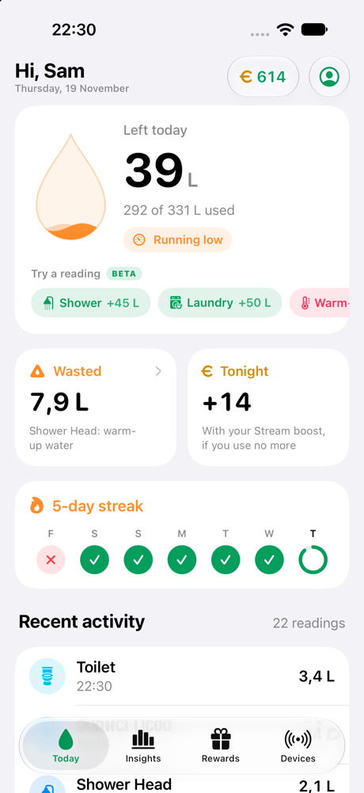
  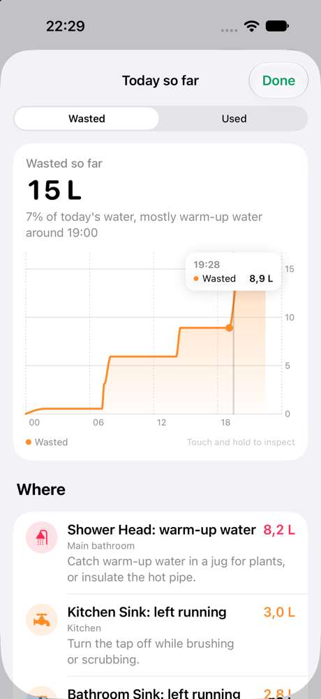
  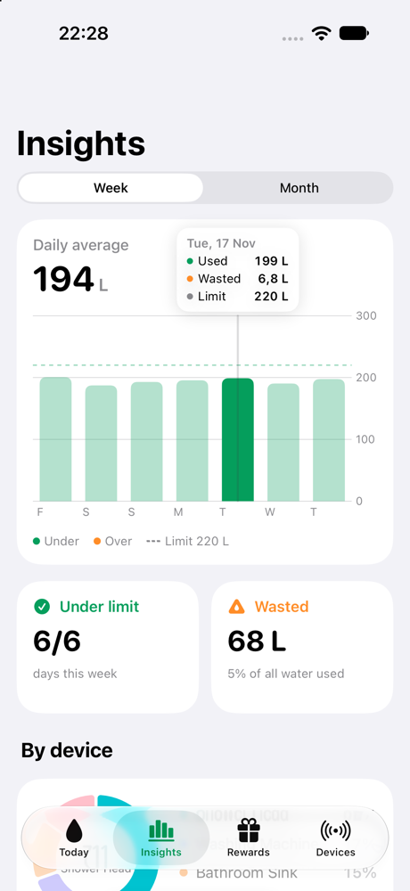
  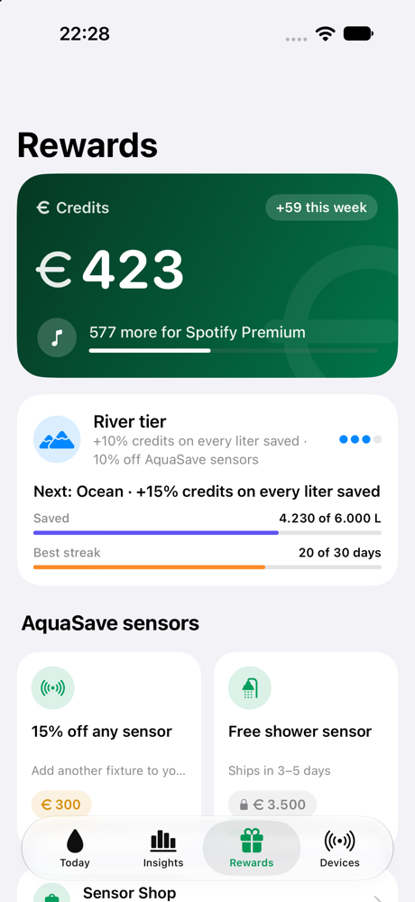
  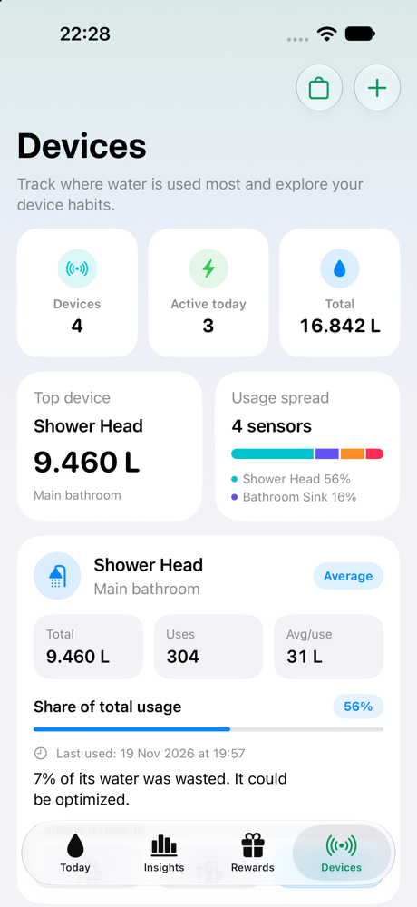
</p>
<p align="center">
  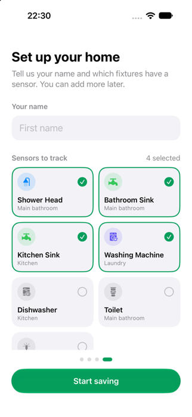
  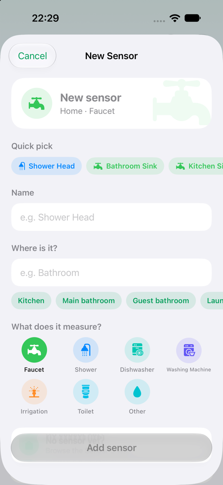
  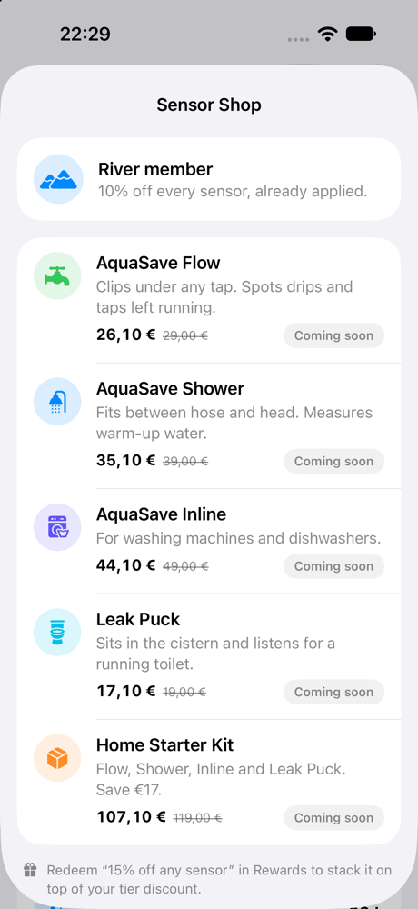
  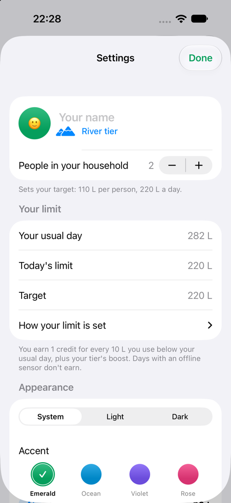
  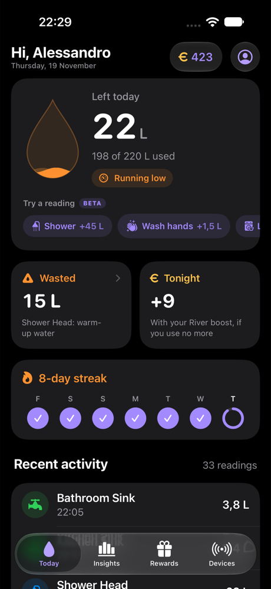
</p>

- **Platforms:** iOS 26.2+, plus a Home Screen widget
- **Language:** Swift with SwiftUI, SwiftData and Swift Charts. No third-party dependencies.
- **Privacy:** everything stays on the iPhone. No account, no network, no analytics.
- **Status:** a working concept. The sensors don't exist yet, so the app runs on realistic simulated readings (see [Status](#status-what-is-verified-and-what-isnt)).

---

## Contents

1. [What it does](#what-it-does)
2. [How it works](#how-it-works)
3. [The limit and the credits](#the-limit-and-the-credits)
4. [Design](#design)
5. [Privacy](#privacy)
6. [Technologies](#technologies)
7. [Project structure](#project-structure)
8. [Build and run](#build-and-run)
9. [Status: what is verified and what isn't](#status-what-is-verified-and-what-isnt)

---

## What it does

1. **Set up.** Onboarding explains the sensors and the credits, asks how many people live in the household, then asks for your name and which fixtures have a sensor (shower, sinks, washing machine, dishwasher, toilet, garden).
2. **Measure.** For the first 14 days AquaSave learns your home's usual day. Today shows "Measuring · day N of 14" and no credits are paid yet.
3. **Stay under the limit.** After that, Today shows a drop that drains as you use water: liters left, liters used, and whether you're on track, running low or over.
4. **Earn.** At midnight the day settles. Every 10 L you used below your usual day pays 1 credit, plus your tier's boost. The **Tonight** card shows what today will pay if no more water runs.
5. **Spend.** Rewards turns credits into sensor discounts, gift cards or a donation.

Also:

- **Waste, by fixture.** Sensors only flag waste they can prove: a **leak** (water flowing when nothing should run), **warm-up water** (down the drain while waiting for it to get hot) and a tap **left running**. Each one is shown where it happened, like "Kitchen Sink: leak", with the fix for that fixture. Long showers and high flow are choices, not waste, so they don't count.
- **Today so far.** Tap the Wasted card for a running total of used or wasted water through the day, against your limit.
- **Insights.** Week or month: daily use against the limit, share by device, each day split by device, waste per day and the peak waste hour. **Touch and hold, then slide** on any chart to read exact values.
- **Tiers.** Drop, Stream, River and Ocean. Each one needs both liters saved and a best streak, and adds a credit boost and a sensor discount.
- **Track a reward.** Pin a reward and the wallet shows how far you are from it.
- **Devices.** Every sensor with its total, uses, average per use, share of the home's water and waste share. Add sensors with quick picks, location chips and a live preview.
- **Sensor Shop.** The sensor line-up with your tier discount applied, and a note on appliances that will report their own water use.
- **Settings:** name, household size, how the limit is set, System/Light/Dark, four accent colours (Emerald, Ocean, Violet, Rose), beta reading simulators, and a demo data reset.
- **Widget:** today's liters, the daily limit, credits and streak on the Home Screen.

---

## How it works

Sensors produce **readings**. Each reading is a `UsageEvent`: when, how many liters, how many of them were wasted, and what kind of waste. Once a day the **ledger** closes every finished day into an immutable `DayResult`. Balance, streak and tier are all derived from those results, so changing a setting later never rewrites history.

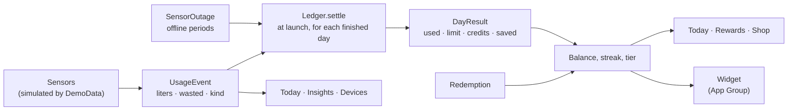

### 1. Data (`AcquaSave/Models/`)

SwiftData models: `Sensor` (name, location, category), `UsageEvent`, `SensorOutage`, `DayResult` and `Redemption`. Deleting a sensor deletes its readings and outages. New fields are optional or have defaults, so existing stores upgrade without a migration plan. The store lives in the App Group container so the widget can share it.

### 2. Settling days (`AcquaSave/Logic/Credits.swift`)

`Ledger.settle` runs whenever the app becomes active and walks every day since the last settled one:

- **Measuring:** the first 14 days earn nothing and set the baseline.
- **Offline:** if any sensor was offline at any point that day, the day earns 0. A sensor that isn't reporting makes a day look thriftier than it was.
- **No readings:** a day with no water at all earns 0, for the same reason.
- **Settled:** credits for the liters saved, with the tier boost the home had *before* that day, so a boost never pays for the day that earned it.

### 3. Waste (`AcquaSave/Logic/WasteStats.swift`)

`WasteKind` defines the three provable kinds, their colours, and the fix for each fixture type ("A dripping tap usually needs a new washer or cartridge"). `WasteStats` groups waste by hour and by fixture, and finds the peak hour.

### 4. Demo data (`AcquaSave/Logic/DemoData.swift`)

Until hardware exists, the app seeds 75 days of plausible readings for the fixtures picked in setup: 14 measuring days of a typical home, then about two months of using less, with a few bad days, one past sensor outage, and realistic waste (warm-up water before showers, night-time drips, taps left on). **Settings › Reset demo data** reseeds for the current sensors.

---

## The limit and the credits

### The limit

```
baseline = average daily use over the first 14 days (days with readings)
         = never more than 144 L per person
limit    = baseline × 0.85 × 0.95^months
         = never below 110 L per person, or below the baseline if the home is already efficient
```

- **110 L per person** is the UK Building Regulations Part G optional standard for water-efficient new homes.
- **144 L per person** is the commonly cited European household average. Capping the baseline means using extra water during the measuring fortnight can't buy an easy limit.
- The limit starts 15% below the baseline and tightens 5% a month until it reaches the target.

### Credits

```
saved   = max(0, baseline − used)
credits = floor(saved × (1 + tier boost) / 10)
```

1 credit is worth about 1 cent, which is €1 per m³ saved, roughly half what the water costs. Credits are paid against the baseline, not the limit, so they follow real savings instead of rewarding a day that only just squeaks under.

### Tiers (`AcquaSave/Logic/Tiers.swift`)

| Tier | Liters saved | Best streak | Credit boost | Sensor discount |
| --- | --- | --- | --- | --- |
| Drop | 0 | 0 days | none | none |
| Stream | 500 L | 5 days | +5% | 5% |
| River | 2,000 L | 14 days | +10% | 10% |
| Ocean | 6,000 L | 30 days | +15% | 15% |

Both bars have to be cleared: savings alone can come from one good month, and a streak alone from a small home.

### Rewards (`AcquaSave/Logic/RewardCatalog.swift`)

| Reward | Credits |
| --- | --- |
| 15% off any sensor | 300 |
| Fund clean water (1,000 L for a family in need) | 300 |
| Spotify Premium, 1 month | 1,000 |
| Amazon gift card, €10 | 1,000 |
| Amazon gift card, €25 | 2,500 |
| Free shower sensor | 3,500 |

Redeeming creates a demo voucher code (`AQS-XXXX-XXXX`). Partner vouchers aren't connected yet.

---

## Design

Tokens live in [`AcquaSave/Design/Theme.swift`](AcquaSave/Design/Theme.swift).

| Token | Light | Dark | Used for |
| --- | --- | --- | --- |
| Emerald (brand) | `#059E5C` | `#33D685` | Accent, the drop, under-limit bars, buttons |
| Credit | `#D68C05` | `#FFC24D` | Credit amounts and the credit sign |

- **Accent themes:** Emerald (default), Ocean, Violet and Rose, chosen in Settings and passed down the view tree as an environment value, so every screen and sheet follows. Chart series colours are independent of the accent so charts stay readable.
- **Credit sign:** a C struck through like €, drawn as a `Shape` so it scales with the text next to it.
- **The drop:** `WaterDrop` is a drop-shaped mask over two sine waves animated with a `TimelineView`. The level drains as the day's limit is used, and the colour turns orange when running low and red when over.
- **Liquid Glass:** iOS 26 tab bar (always visible), glass buttons and toolbar items.
- **Motion:** numbers change with `.contentTransition(.numericText)`. Tapping the balance flips the coin in 3D with a spring and opens a summary. Haptics mark simulator taps, chart inspection and selections.
- **Charts:** inspection is touch-and-hold then slide, so a quick swipe still scrolls the page. The limit's value sits in the legend, never on top of the bars.
- **Devices:** kept close to the original design: header metrics, top device, usage spread and per-device cards with simulate buttons.

Accessibility so far: VoiceOver labels on the drop, credit amounts and simulators, an adjustable action on the household picker, the waves pause with Reduce Motion, and states are spelled out in words, not colour alone. It hasn't had a full VoiceOver pass yet.

---

## Privacy

- Readings, credits and settings are stored on the device in SwiftData and UserDefaults.
- No account, no ads, no analytics, no network code in the app.
- The widget reads a few numbers from the shared App Group, nothing else.

---

## Technologies

| Area | Frameworks and techniques |
| --- | --- |
| Language | Swift, main-actor default isolation with Approachable Concurrency |
| UI | SwiftUI, Liquid Glass (`.glassProminent`, `ToolbarSpacer`, `Tab`), `TimelineView`, keyframe animations, custom `Shape`s |
| Data | SwiftData with cascade relationships and lightweight migration, `@AppStorage` |
| Charts | Swift Charts: bar, line, area, sector and rule marks, `chartXSelection`, `chartAngleSelection`, custom `chartGesture` |
| Widget | WidgetKit, App Group shared storage |
| Checks | `#if DEBUG` self-checks for the limit, credits, tiers and waste maths, run at launch |
| Tooling | Xcode 27.2, synchronized folders (objectVersion 77) |

---

## Project structure

```
AcquaSave/
├── AcquaSave/                   iPhone app
│   ├── Models/                  SwiftData models, device categories, sensor presets
│   ├── Logic/                   Credits and ledger, tiers, waste stats, reward catalog, demo data
│   ├── Design/                  Theme and credit sign, water drop, waste charts and lists
│   ├── Services/                WidgetBridge (App Group)
│   └── Views/
│       ├── Onboarding/          Four-step setup
│       ├── Today/               Today and the "Today so far" trend
│       ├── Insights/            Charts with touch-and-hold inspection
│       ├── Rewards/             Wallet, tiers, reward cards, redeem, credit history
│       ├── Devices/             Sensor list and the New Sensor sheet
│       ├── Shop/                Sensor Shop
│       └── Settings/            Profile, limit, appearance, beta, reset
├── AquaSaveWidget/              Home Screen widget
└── .github/                     Banner and README screenshots
```

---

## Build and run

Requirements: Xcode 27.2 (iOS 26.2 SDK or later) on macOS. Open `AcquaSave.xcodeproj`, pick the **AcquaSave** scheme and run. Signing uses your own team. The App Group is `group.com.alessandrosignorile.AquaSave`.

From the command line (if `xcode-select` points at the Command Line Tools, prefix the command with `DEVELOPER_DIR=/Applications/Xcode.app/Contents/Developer`):

```bash
xcodebuild build -project AcquaSave.xcodeproj -scheme AcquaSave -destination 'generic/platform=iOS Simulator' CODE_SIGNING_ALLOWED=NO
```

The first launch shows onboarding. Finishing it seeds the demo data for the fixtures you picked. To try things without waiting for real days to pass, use the beta **Try a reading** buttons on Today (shower, hand wash, laundry, warm-up, tap left on, leak), the +2/+5/+20 L buttons on each device, or long-press a device to simulate it going offline.

---

## Status: what is verified and what isn't

**Verified**

- Builds for the iOS simulator with no errors.
- Every screen checked in the iPhone 18 Pro simulator, in light and dark mode and with a non-default accent.
- An existing store from the previous version upgrades in place: all days and credits kept, new fields added.
- Onboarding seeds only the fixtures picked, and the ledger pays tier bonuses.
- The limit, credit, tier and waste maths pass their debug self-checks.

**Not verified yet**

- Real sensors. There is no hardware, so every reading is simulated.
- Touch-and-hold chart inspection and the coin flip, by hand on a device. Their resting and selected states were checked in screenshots.
- Shop prices and products are placeholders, and the buy buttons say "Coming soon" until `ShopView.storeURL` is set.
- The widget target still contains Xcode's template Control and Live Activity.
- There is no unit test target yet; the maths is covered only by the debug self-checks.

**Next steps:** a sensor prototype that reports flow, partner vouchers for real reward codes, and a unit test target for the ledger.

---

© 2026 Alessandro Signorile. All rights reserved.
